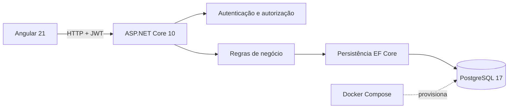

<div align="center">
  

  # HelpDesk Flow

  **Central web para abertura, triagem e acompanhamento de chamados de suporte.**

  [](https://dotnet.microsoft.com/)
  [](https://angular.dev/)
  [](https://www.postgresql.org/)
  [](https://www.docker.com/)
</div>

---

## Sobre o projeto

O HelpDesk Flow é uma aplicação full stack criada para praticar o ecossistema **C# e ASP.NET Core** em um cenário próximo de um produto real. O frontend foi desenvolvido em **Angular**, com uma interface responsiva voltada à rotina de uma equipe de suporte.

O sistema cobre o fluxo completo de um chamado:

```text
ABERTO → EM ANDAMENTO → RESOLVIDO → FECHADO
```

Também estão disponíveis cancelamento e reabertura de chamados resolvidos.

## Funcionalidades

- Cadastro e autenticação com JWT
- Autorização baseada em perfis
- Abertura, edição e acompanhamento de chamados
- Filtros por situação, prioridade e busca textual
- Paginação da fila de atendimento
- Comentários e histórico de atualização
- Priorização e mudança de situação
- Técnico pode pegar chamados livres
- Atribuição e reatribuição exclusivas para administradores
- Administração de usuários e perfis
- Erros padronizados com Problem Details
- Documentação interativa com Swagger
- Seeds e dados simulados para demonstração
- Migrações automáticas em desenvolvimento
- PostgreSQL persistente com Docker
- Interface responsiva para desktop e dispositivos móveis

## Perfis de acesso

| Perfil | Permissões principais |
| --- | --- |
| **Solicitante** | Abre chamados, acompanha os próprios atendimentos, edita seus chamados e publica comentários |
| **Técnico** | Visualiza a fila, pega chamados sem responsável, altera prioridade e situação e publica comentários |
| **Administrador** | Gerencia usuários e perfis, consulta toda a fila e atribui ou reatribui responsáveis |

As regras também são aplicadas no backend. Um técnico não consegue atribuir um chamado para outra pessoa chamando diretamente a API.

## Tecnologias

| Área | Tecnologias |
| --- | --- |
| Backend | C#, ASP.NET Core 10, Entity Framework Core, Npgsql |
| Frontend | Angular 21, TypeScript, Signals, HttpClient |
| Banco de dados | PostgreSQL 17 |
| Segurança | JWT Bearer, Password Hasher, autorização por perfil, rate limiting |
| Documentação | OpenAPI e Swagger UI |
| Infraestrutura | Docker Compose, migrations e seeds |
| Qualidade | Testes automatizados de integração e scripts PowerShell |

## Arquitetura



O frontend compilado é servido pela API no ambiente local. Durante o desenvolvimento, o Angular também pode ser executado separadamente com hot reload e proxy para `/api`.

## Executar localmente

### Pré-requisitos

- Docker Desktop
- .NET SDK 10
- Node.js 24
- PowerShell 7.4 ou superior

Com o Docker Desktop iniciado, execute na raiz do repositório:

```powershell
pwsh -NoProfile -ExecutionPolicy Bypass -File .\scripts\start-local.ps1
```

O script gera credenciais em `.env.helpdesk`, inicia o PostgreSQL, instala as dependências necessárias, compila o Angular, aplica as migrações, cria os dados de demonstração e inicia a aplicação.

| Serviço | Endereço |
| --- | --- |
| Aplicação | [http://localhost:5031](http://localhost:5031) |
| Swagger | [http://localhost:5031/swagger](http://localhost:5031/swagger) |
| PostgreSQL | `127.0.0.1:55432` |

## Contas de demonstração

| E-mail | Perfil |
| --- | --- |
| `usuario@helpdesk.test` | Solicitante |
| `tecnico@helpdesk.test` | Técnico |
| `admin@helpdesk.test` | Administrador |

As três contas usam a senha do campo `HELPDESK_DEMO_PASSWORD` no arquivo local `.env.helpdesk`.

> O arquivo `.env.helpdesk` é ignorado pelo Git. Senhas, tokens e chaves locais não são versionados.

### Fluxo sugerido

1. Entre como solicitante e abra um chamado
2. Copie o código exibido na fila
3. Entre como técnico e localize o chamado
4. Clique em **Pegar chamado**
5. Mude a situação para **Em andamento**
6. Adicione um comentário e marque como **Resolvido**
7. Entre como administrador para testar atribuição, reatribuição e gestão de perfis

## Desenvolvimento do frontend

Inicie apenas a API e o banco:

```powershell
pwsh -NoProfile -File .\scripts\start-local.ps1 -ApiOnly
```

Em outro terminal:

```powershell
npm.cmd --prefix frontend ci
npm.cmd --prefix frontend start
```

O Angular estará disponível em [http://localhost:4200](http://localhost:4200). O proxy encaminha as chamadas de `/api` para a porta `5031`.

## Testes automatizados

Com a API local em execução:

```powershell
pwsh -NoProfile -File .\scripts\test-api.ps1
```

O teste de integração cria dados identificados pelo prefixo `teste-` e valida:

- Cadastro, login, credenciais inválidas e e-mail duplicado
- Isolamento de chamados entre solicitantes
- Permissões de solicitante, técnico e administrador
- Edição parcial sem perda de dados
- Busca, filtros e paginação
- Técnico pegando um chamado livre
- Bloqueio de atribuição por técnico
- Atribuição e reatribuição por administrador
- Comentários
- Resolução, reabertura e fechamento
- Bloqueio de alterações em chamados finalizados
- Alteração de perfil e invalidação da sessão anterior

O arquivo [`HelpDesk-Flow.http`](./HelpDesk-Flow.http) contém exemplos adicionais para testes manuais.

## Principais endpoints

| Método | Rota | Descrição |
| --- | --- | --- |
| `POST` | `/api/auth/register` | Cadastra um solicitante |
| `POST` | `/api/auth/login` | Autentica e retorna o JWT |
| `GET` | `/api/auth/me` | Retorna o usuário autenticado |
| `GET` | `/api/tickets` | Lista chamados com filtros e paginação |
| `POST` | `/api/tickets` | Abre um chamado |
| `PUT` | `/api/tickets/{id}` | Edita os dados permitidos |
| `PATCH` | `/api/tickets/{id}/take` | Técnico pega um chamado livre |
| `PATCH` | `/api/tickets/{id}/assign` | Administrador atribui o responsável |
| `PATCH` | `/api/tickets/{id}/status` | Altera a situação |
| `GET` | `/api/tickets/{id}/comments` | Lista comentários |
| `POST` | `/api/tickets/{id}/comments` | Publica um comentário |
| `GET` | `/api/users` | Lista usuários para administração |
| `PATCH` | `/api/users/{id}/role` | Altera o perfil de um usuário |

## Estrutura do repositório

```text
HelpDesk-Flow/
├── Controllers/        Endpoints HTTP e autorização
├── Data/               DbContext, factory e seeds
├── DTOs/               Contratos externos da API
├── Enums/              Perfis, prioridades e situações
├── Migrations/         Histórico do schema PostgreSQL
├── Models/             Entidades persistidas
├── Repositories/       Consultas e acesso aos dados
├── Services/           Regras de negócio
├── frontend/           Aplicação Angular
├── scripts/            Inicialização e testes
├── compose.yaml        PostgreSQL local
└── Program.cs          Configuração da aplicação
```

## Configuração

| Configuração | Uso |
| --- | --- |
| `ConnectionStrings__DefaultConnection` | Conexão com o PostgreSQL |
| `Jwt__Key` | Chave de assinatura com pelo menos 32 bytes |
| `Jwt__Issuer` | Emissor do token |
| `Jwt__Audience` | Audiência do token |
| `Jwt__ExpirationMinutes` | Tempo de expiração |
| `AllowedOrigins__0` | Origem permitida pelo CORS |
| `Demo__Password` | Senha das contas de demonstração |

## Encerrar o ambiente

Encerre a API com `Ctrl+C`. Para parar o PostgreSQL preservando os dados:

```powershell
docker compose --env-file .env.helpdesk stop
```

Os dados permanecem armazenados no volume `helpdesk-flow-local_pgdata`.

---

<div align="center">
  Desenvolvido como projeto de estudo prático de C#, ASP.NET Core e Angular.
</div>
